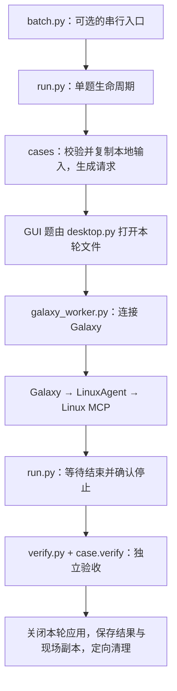

# Project Directory Structure

本文开头介绍同级仓库 `AgentArena/src/linux-arena-container/` 的 Linux 评测目录；后文保留 UFO3 原有的整体目录说明。

<a id="agentarena-linux"></a>

## AgentArena Linux 评测目录

核对日期：2026-11-06。第三步 MVP 已实现并注册 10 个案例，包含 7 个 CLI 案例和 3 个 GUI 案例。代码接入与端到端通过分别记录，实际运行结果见 AgentArena 的 `STAGE3_VALIDATION.md`。

### 位置与职责

```text
GUI-Agent/
├── AgentArena/
│   ├── agent.md                         # 项目目标、阶段计划与交接约定
│   ├── docs/OSWorld-Linux-Migration-Plan.md
│   └── src/linux-arena-container/        # 本文介绍的评测程序
└── UFO3/
    ├── galaxy/                          # 规划任务并调度设备
    ├── ufo/                             # LinuxAgent、设备客户端与 MCP
    └── documents/docs/project_directory_structure.md
```

AgentArena 负责准备素材、检查初始状态、提交任务、等待结束、独立验收、记录结果和清理。UFO3 中的 Galaxy 负责规划，LinuxAgent 与 Linux MCP 负责执行。目录名中的 `container` 沿用项目命名，当前实现直接运行在本机 Linux，不依赖 Docker 或虚拟机。

### 目录总览

以下省略 `__pycache__/`、具体运行编号及部分素材文件名。

```text
linux-arena-container/
├── README.md                            # 使用说明、前置条件、命令与结果解释
├── VALIDATION.md                        # 第一阶段真实执行的历史记录
├── STAGE3_VALIDATION.md                  # 第三步验证结果与历史记录
├── run.py                               # 单题入口与生命周期管理
├── galaxy_worker.py                     # 独立子进程中的 Galaxy 接入
├── batch.py                             # 按 suite 串行执行并汇总
├── desktop.py                           # 打开本轮 VS Code / Calc 独立实例
├── requirements.txt                     # Calc 验收依赖 openpyxl
├── prepare_assets.py                    # 显式下载素材、离线校验版本与哈希
├── verify.py                            # 提取真实答案、检查设备读取轨迹
├── review.py                            # 为待复核结果记录人工决定
├── cases/
│   ├── __init__.py                      # 显式注册表 CASES 与 get_case()
│   ├── common.py                        # 输入复制、完整性与只读验收辅助
│   ├── logs.py                          # ERROR 日志统计与字段提取
│   ├── config.py                        # 配置文件差异比较
│   ├── php_line_count.py                # 递归统计 PHP 文件行数
│   ├── replace_text.py                  # VS Code 保存文本比较
│   ├── collect_jpg.py                   # 递归复制 JPG
│   ├── collect_failed_notebooks.py      # 保留层级收集 notebook
│   ├── normalize_permissions.py        # 普通文件权限统一为 644
│   ├── archive_by_age.py               # 根据 mtime 压缩和移动文件
│   ├── zoom_out.py                     # Calc 保存缩放比例比较
│   ├── monthly_sales.py                # Calc 六个月销售额比较
│   └── workbooks.py                    # 读取保存的工作簿值和缩放
├── fixtures/                            # 固定输入；不是每轮操作现场
│   ├── logs/app.log
│   ├── config/{before.conf,after.conf}
│   ├── php_line_count/project/           # index.php、models/、views/、controllers/
│   ├── collect_jpg/photos/               # 原层级的 JPG/PNG 图片
│   ├── collect_failed_notebooks/project/ # 五份固定非空 notebook
│   ├── normalize_permissions/testDir/    # 三份固定文本，setup 设置权限
│   ├── archive_by_age/test_files/        # 四份固定文本，setup 设置 mtime
│   ├── replace_text/                    # VS Code 替换任务的原文本
│   ├── zoom_out/                        # Calc 缩放任务的输入工作簿
│   └── monthly_sales/                   # Calc 销售汇总任务的输入工作簿
├── references/                          # 评测端参考文件，不复制到任务现场
│   ├── replace_text/
│   ├── zoom_out/
│   └── monthly_sales/
├── provenance/
│   ├── README.md                        # 来源、许可、适配差异与准备状态
│   ├── assets.lock.json                 # 固定版本、URL、用途、大小及 SHA-256
│   └── upstream/
│       ├── LICENSE.OSWorld              # 上游源码许可证
│       ├── dataset-metadata.json        # 数据集版本与许可声明摘要
│       ├── <case_id>.json               # 8 道 OSWorld 原题定义
│       └── <case_id>/*.sh               # 仅供审查的原初始化/评分脚本
├── suites/
│   ├── baseline.json                    # logs、config
│   ├── pilots.json                      # PHP 和 VS Code 两个试点
│   └── linux10.json                     # 全部 10 题已启用
├── tests/
│   ├── test_arena.py                    # 原有验收、素材与生命周期回归
│   └── test_stage3_cases.py             # 新题正确/错误产物及自然答案检查
└── runs/                                # 默认运行产物与证据目录
    ├── .lock                            # 单题/批次共用的本地互斥锁
    ├── arena-<UTC时间>-<随机后缀>/        # 独立单题运行
    ├── batch-<UTC时间>-<随机后缀>/        # 串行批次及其子题
    └── stage3-20261105-summary.json      # 已保存的第三步首版汇总快照
```

原来的 `cases.py` 已拆成 `cases/` 包；新增案例应放进对应模块并显式注册，不再向旧文件追加逻辑。

### 核心文件如何配合

| 文件 | 主要职责 | 关键接口或输出 |
| --- | --- | --- |
| `run.py` | 创建独立目录，初始化并提交一题；控制超时、确认停止后验收和清理 | `run_case(args)` 返回结果摘要，`run(args)` 返回退出码；写入 `result.json` |
| `galaxy_worker.py` | 在独立进程中连接或启动本机服务，通过 `GalaxyClient` 执行请求并保存真实任务结果 | `start_local()`、`execute()`；写入初始化、提交标记和执行记录 |
| `batch.py` | 读取固定 suite，逐题调用 `run_case()`，按 CLI/GUI 分组统计；不自动重试 | `load_suite()`、`execute_suite()`；保存 `suite.json`、`summary.json` |
| `desktop.py` | 用固定命令打开本轮应用和独立 profile；runner 在判分后停止本轮实例 | `open_application()` 返回应用进程；写入 `application.log` |
| `prepare_assets.py` | 按锁文件显式下载缺失的远程素材，或仅检查本地文件；拒绝哈希不符与越界/链接路径 | `manifest()`、`check_case()`、`prepare()`；`--check` 不联网 |
| `verify.py` | 从实际设备终点结果提取答案，并检查本轮材料路径对应的有效 MCP 读取/行数统计轨迹 | `final_answer()`、`check_reads()` |
| `review.py` | 将人工核对决定写入待复核记录，保留原自动验收信息 | `record_review()`；新增 `review.json`，更新该轮 `result.json` |



图中是正常执行路径。初始化失败时不会下发任务，超时会跳过正常验收；若无法确认操作停止，则保留现场并停止批次后续题目。Galaxy 的 `completed`、进程退出码 0 与验收通过是不同层面的状态。

### 案例模块与注册表

每个已实现案例集中定义以下内容，服务启动和进程管理仍由 runner/worker 负责。

| 定义 | 含义 |
| --- | --- |
| `ID`、`MODE` | 案例标识与交互方式：`cli` 或 `gui` |
| `VERSION` | 案例与验收版本，写入结果记录 |
| `REQUEST_VERSION` | 可选的独立请求版本；未定义时使用 `VERSION` |
| `setup(work)` | 校验本地素材，复制输入到本轮 `materials/`，返回哈希及验收需要的初始状态 |
| `make_request(work)` | 生成自然语言任务，只提供任务意图和必要素材位置 |
| `verify(work, state, answers, traces)` | 三个只读题比较答案和读取轨迹，新增七题直接比较保存产物 |
| `ARTIFACT` | 新七题设为 `True`，产物评分不依赖完成语句的格式 |
| `APPLICATION`、`FILENAME` | GUI 题声明应用和输入，runner 在初始化时打开 |
| `cleanup(work, state)` | 可选；权限题判分后恢复本轮文件的访问权限以便清理 |

`cases/__init__.py` 显式导入十个案例模块并维护 `CASES`。`common.py` 复用输入初始化与文件比较；没有自动发现或案例继承体系。

| 案例 | 当前实现与验收 |
| --- | --- |
| `logs` | 统计 ERROR 日志及有序的 request_id、code；验收 v3 支持结构化数据及明确的自然数量/字段行。 |
| `config` | 比较配置变化及前后值；参考值定义在案例模块，验收方式与 logs 相同。 |
| `php_line_count` | 初始化时独立计算所有 PHP 文件的换行字节数；核对明确的总行数回答及各文件的读取/统计证据。歧义或冲突表述待复核。 |

`references/` 并不包含所有案例的标准答案：前两个案例在模块中定义参考值，PHP 在初始化时从固定素材独立计算。参考值与运行元数据留在评测端，不拼入任务请求。

### 素材与现场的区别

| 位置 | 用途 | 是否直接交给 Agent 操作 |
| --- | --- | --- |
| `fixtures/<case_id>/` | 可重复复制的固定输入 | 否；每轮先复制到独立目录 |
| `references/<case_id>/` | 文本或工作簿的参考产物 | 否 |
| `provenance/` | 追踪原题、版本、下载来源、许可和评分改动 | 否 |
| `runs/<run_id>/materials/` | 本轮实际任务现场 | 是；请求只引用必要位置 |
| `runs/<run_id>/evidence/materials/` | 确认停止后保存的现场副本，供复核使用 | 否；属于评测证据 |

提前准备素材用 `prepare_assets.py`；正式执行时 `setup()` 只检查本地文件，不自动联网补下载。`upstream/` 内的 shell 脚本是审查资料，不能直接作为宿主机初始化或评分命令执行。

当前锁文件记录 45 个条目，含 12 份新增本地固定输入；源码固定到 OSWorld 提交 `8903ebeb0efdf74331bd7dc37ed91ccbbff22317`，素材另有数据集 revision 与逐文件哈希。来源及许可细节以 `provenance/README.md` 和锁文件为准。

### 单题与批次产物

一轮成功到达各阶段后，目录大致如下；早期失败时可能没有后续阶段文件。

```text
runs/arena-.../
├── result.json                 # 总状态、各阶段状态、版本、耗时、错误及路径
├── request.json                # 实际请求与 worker 连接所需元数据
├── materials.json              # 本轮素材位置、哈希及必要的初始参考状态
├── initialization.json         # 设备连接初始化结果或初始化错误
├── submission.json             # 调用 Galaxy 前写入的提交标记
├── execution.json              # Galaxy 返回、设备任务结果和停止确认信息
├── answer.json                 # 从实际终点结果提取的原始回答
├── materials/                  # 确认停止并保存证据后删除；停止不明则保留
├── evidence/materials/         # 保存的素材证据副本
├── traces/                     # 本轮 Galaxy/设备 response.log 副本
├── galaxy.log                  # worker 标准输出和错误日志
├── application.log             # GUI 应用启动日志
├── mcp.log                     # 本轮启动本地服务时才有以下三个服务日志
├── server.log
├── device.log
└── review.json                 # 人工复核后才产生

runs/batch-.../
├── suite.json                  # 本次采用的计划快照
├── summary.json                # 全部计划条目、逐题路径、状态和 CLI/GUI 汇总
└── runs/arena-.../              # 各题完整记录，结构同上
```

`result.json` 区分 `passed`、`initialization_failed`、`execution_failed`、`timeout`、`verification_failed`、`verification_error`、`review_required`、`interrupted` 和 `cleanup_failed`。批次另保留 `running`、`not_executed`，不能将未执行或待复核项算作通过。

人工复核只处理 `review_required`，原自动检查不被覆盖。批次汇总是结束时的快照，后续人工决定应查看具体题目的 `result.json`。本地锁位于默认 `runs/.lock`，即便用 `--output` 改变结果目录，锁的位置也不会改变。

### suite 中的新增案例

`baseline.json` 运行日志与配置两题，`pilots.json` 运行 PHP 与 VS Code，`linux10.json` 串行运行全部十题。全部条目已启用；执行前需由 UFO 提供对应工具服务。

| 计划案例 | 已有材料 | 当前代码状态 |
| --- | --- | --- |
| `collect_jpg` | 原层级图片输入 | 已实现；比较复制的 JPG 和保留的源文件 |
| `collect_failed_notebooks` | 五份非空 notebook | 已实现；比较目标相对路径和内容 |
| `normalize_permissions` | 三份非空文件 | 已实现；比较 644 权限、内容和目录权限 |
| `archive_by_age` | 四份非空文件，setup 设置 mtime | 已实现；比较 ZIP 成员和被移动的新文件 |
| `replace_text` | 原文本及参考文本 | 已实现；打开 VS Code，比较实际保存文本 |
| `zoom_out`、`monthly_sales` | 输入与参考工作簿 | 已实现；打开 Calc，比较保存缩放或月汇总 |

UFO 工具由另一项工作提供；评测端不增加 GUI 轨迹审计或审核流程。GUI 需要本机桌面及 `code` / `libreoffice` 命令。实际运行与代码实现状态分别记录，详见 AgentArena 的 `STAGE3_VALIDATION.md`。

### 常用入口与阅读顺序

以下命令在 `AgentArena/` 仓库根目录执行，使用已经配置好 UFO3 依赖的 Python 环境：

```bash
# 安装 Calc 结果读取依赖
python -m pip install -r src/linux-arena-container/requirements.txt

# 只做素材检查或查看计划，不提交任务
python src/linux-arena-container/prepare_assets.py --check
python src/linux-arena-container/batch.py --list

# 单题真实执行；--local-services 启动本轮专用本机服务
python src/linux-arena-container/run.py --case php_line_count --local-services

# 顺序运行 baseline 中的两题
python src/linux-arena-container/batch.py \
  --suite src/linux-arena-container/suites/baseline.json --local-services

# 离线回归，不调用模型或设备
python -m unittest discover -s src/linux-arena-container/tests -v
```

`run.py` 默认在同级 `UFO3/` 查找 Galaxy；可用 `--ufo-root`、`--device`、`--output` 和 `--timeout` 指定路径、设备、结果目录及时间限制。`--local-services` 复用 UFO3 的 Linux MCP 端口配置，并拒绝占用已被使用的端口。

第一次阅读建议按 `README.md → cases/__init__.py → cases/php_line_count.py → run.py → galaxy_worker.py → verify.py → batch.py` 的顺序，最后结合两份验证记录理解实际运行结果。修改单题业务时先看该题模块；排查服务连接看 worker；排查成绩看 verifier、该题的 `verify()` 与本轮证据。

新增案例时，应同时准备和锁定素材、实现案例模块、显式注册、更新 suite，并验证错误答案或错误产物不会通过。服务和进程逻辑不复制进每个案例；只有真实链路验证完成后，才在验证记录中报告已跑通。

---

## UFO3 项目总览

This repository implements **UFO³**, a multi-tier AgentOS architecture spanning from single-device automation (UFO²) to cross-device orchestration (Galaxy). This document provides an overview of the directory structure to help you understand the codebase organization.

> **New to UFO³?** Start with the [Documentation Home](index.md) for an introduction and [Quick Start Guide](getting_started/quick_start_galaxy.md) to get up and running.

**Architecture Overview:**

- **🌌 Galaxy**: Multi-device DAG-based orchestration framework that coordinates agents across different platforms
- **🎯 UFO²**: Single-device Windows desktop agent system that can serve as Galaxy's sub-agent
- **🔌 AIP**: Agent Integration Protocol for cross-device communication
- **⚙️ Modular Configuration**: Type-safe configs in `config/galaxy/` and `config/ufo/`

---

## 📦 Root Directory Structure

```
UFO/
├── galaxy/                 # 🌌 Multi-device orchestration framework
├── ufo/                    # 🎯 Desktop AgentOS (can be Galaxy sub-agent)
├── config/                 # ⚙️ Modular configuration system
├── aip/                    # 🔌 Agent Integration Protocol
├── documents/              # 📖 MkDocs documentation site
├── vectordb/               # 🗄️ Vector database for RAG
├── learner/                # 📚 Help document indexing tools
├── record_processor/       # 🎥 Human demonstration parser
├── dataflow/               # 📊 Data collection pipeline
├── model_worker/           # 🤖 Custom LLM deployment tools
├── logs/                   # 📝 Execution logs (auto-generated)
├── scripts/                # 🛠️ Utility scripts
├── tests/                  # 🧪 Unit and integration tests
└── requirements.txt        # 📦 Python dependencies
```

---

## 🌌 Galaxy Framework (`galaxy/`)

The cross-device orchestration framework that transforms natural language requests into executable DAG workflows distributed across heterogeneous devices.

### Directory Structure

```
galaxy/
├── agents/                 # 🤖 Constellation orchestration agents
│   ├── agent/              # ConstellationAgent and basic agent classes
│   ├── states/             # Agent state machines
│   ├── processors/         # Request/result processing
│   └── presenters/         # Response formatting
│
├── constellation/          # 🌟 Core DAG management system
│   ├── task_constellation.py    # TaskConstellation - DAG container
│   ├── task_star.py        # TaskStar - Task nodes
│   ├── task_star_line.py   # TaskStarLine - Dependency edges
│   ├── enums.py            # Enums for constellation components
│   ├── editor/             # Interactive DAG editing with undo/redo
│   └── orchestrator/       # Event-driven execution coordination
│
├── session/                # 📊 Session lifecycle management
│   ├── galaxy_session.py   # GalaxySession implementation
│   └── observers/          # Event-driven observers
│
├── client/                 # 📡 Device management
│   ├── constellation_client.py              # Device registration interface
│   ├── device_manager.py                    # Device management coordinator
│   ├── config_loader.py                     # Configuration loading
│   ├── components/         # Device registry, connection manager, etc.
│   └── support/            # Client support utilities
│
├── core/                   # ⚡ Foundational components
│   ├── types.py            # Type system (protocols, dataclasses, enums)
│   ├── interfaces.py       # Interface definitions
│   ├── di_container.py     # Dependency injection container
│   └── events.py           # Event system
│
├── visualization/          # 🎨 Rich console visualization
│   ├── dag_visualizer.py   # DAG topology visualization
│   ├── task_display.py     # Task status displays
│   └── components/         # Visualization components
│
├── prompts/                # 💬 Prompt templates
│   ├── constellation_agent/ # ConstellationAgent prompts
│   └── share/              # Shared examples
│
├── trajectory/             # 📈 Execution trajectory parsing
│
├── __main__.py             # 🚀 Entry point: python -m galaxy
├── galaxy.py               # Main Galaxy orchestrator
├── galaxy_client.py        # Galaxy client interface
├── README.md               # Galaxy overview
└── README_ZH.md            # Galaxy overview (Chinese)
```

### Key Components

| Component | Description | Documentation |
|-----------|-------------|---------------|
| **ConstellationAgent** | AI-powered agent that generates and modifies task DAGs | [Galaxy Overview](galaxy/overview.md) |
| **TaskConstellation** | DAG container with validation and state management | [Constellation](galaxy/constellation/overview.md) |
| **TaskOrchestrator** | Event-driven execution coordinator | [Constellation Orchestrator](galaxy/constellation_orchestrator/overview.md) |
| **DeviceManager** | Multi-device coordination and assignment | [Device Manager](galaxy/client/device_manager.md) |
| **Visualization** | Rich console DAG monitoring | [Galaxy Overview](galaxy/overview.md) |

**Galaxy Documentation:**

- [Galaxy Overview](galaxy/overview.md) - Architecture and concepts
- [Quick Start](getting_started/quick_start_galaxy.md) - Get started with Galaxy
- [Constellation Agent](galaxy/constellation_agent/overview.md) - AI-powered task planning
- [Constellation Orchestrator](galaxy/constellation_orchestrator/overview.md) - Event-driven coordination
- [Device Manager](galaxy/client/device_manager.md) - Multi-device management

---

## 🎯 UFO² Desktop AgentOS (`ufo/`)

Single-device desktop automation system implementing a two-tier agent architecture (HostAgent + AppAgent) with hybrid GUI-API automation.

### Directory Structure

```
ufo/
├── agents/                 # Two-tier agent implementation
│   ├── agent/              # Base agent classes (HostAgent, AppAgent)
│   ├── states/             # State machine implementations
│   ├── processors/         # Processing strategy pipelines
│   ├── memory/             # Agent memory and blackboard
│   └── presenters/         # Response presentation logic
│
├── server/                 # Server-client architecture components
│   ├── websocket_server.py # WebSocket server for remote agent control
│   └── handlers/           # Request handlers
│
├── client/                 # MCP client and device management
│   ├── mcp/                # MCP server manager
│   │   ├── local_servers/  # Built-in MCP servers (UI, CLI, Office COM)
│   │   └── http_servers/   # Remote MCP servers (hardware, Linux)
│   ├── ufo_client.py       # UFO² client implementation
│   └── computer.py         # Computer/device abstraction
│
├── automator/              # GUI and API automation layer
│   ├── ui_control/         # GUI automation (inspector, controller)
│   ├── puppeteer/          # Execution orchestration
│   └── *_automator.py      # App-specific automators (Excel, Word, etc.)
│
├── prompter/               # Prompt construction engines
├── prompts/                # Jinja2 prompt templates
│   ├── host_agent/         # HostAgent prompts
│   ├── app_agent/          # AppAgent prompts
│   └── share/              # Shared components
│
├── llm/                    # LLM provider integrations
├── rag/                    # Retrieval-Augmented Generation
├── trajectory/             # Task trajectory parsing
├── experience/             # Self-experience learning
├── module/                 # Core modules (session, round, context)
├── config/                 # Legacy config support
├── logging/                # Logging utilities
├── utils/                  # Utility functions
├── tools/                  # CLI tools (config conversion, etc.)
│
├── __main__.py             # Entry point: python -m ufo
└── ufo.py                  # Main UFO² orchestrator
```

### Key Components

| Component | Description | Documentation |
|-----------|-------------|---------------|
| **HostAgent** | Desktop-level orchestration with 7-state FSM | [HostAgent Overview](ufo2/host_agent/overview.md) |
| **AppAgent** | Application-level execution with 6-state FSM | [AppAgent Overview](ufo2/app_agent/overview.md) |
| **MCP System** | Extensible command execution framework | [MCP Overview](mcp/overview.md) |
| **Automator** | Hybrid GUI-API automation with fallback | [Core Features](ufo2/core_features/hybrid_actions.md) |
| **RAG** | Knowledge retrieval from multiple sources | [Knowledge Substrate](ufo2/core_features/knowledge_substrate/overview.md) |

**UFO² Documentation:**

- [UFO² Overview](ufo2/overview.md) - Architecture and concepts
- [Quick Start](getting_started/quick_start_ufo2.md) - Get started with UFO²
- [HostAgent States](ufo2/host_agent/state.md) - Desktop orchestration states
- [AppAgent States](ufo2/app_agent/state.md) - Application execution states
- [As Galaxy Device](ufo2/as_galaxy_device.md) - Using UFO² as Galaxy sub-agent
- [Creating Custom Agents](tutorials/creating_app_agent/overview.md) - Build your own application agents

---

## 🔌 Agent Integration Protocol (`aip/`)

Standardized message passing protocol for cross-device communication between Galaxy and UFO² agents.

```
aip/
├── messages.py             # Message types (Command, Result, Event, Error)
├── protocol/               # Protocol definitions
├── transport/              # Transport layers (HTTP, WebSocket, MQTT)
├── endpoints/              # API endpoints
├── extensions/             # Protocol extensions
└── resilience/             # Retry and error handling
```

**Purpose**: Enables Galaxy to coordinate UFO² agents running on different devices and platforms through standardized messaging over HTTP/WebSocket.

**Documentation**: See [AIP Overview](aip/overview.md) for protocol details and [Message Types](aip/messages.md) for message specifications.

---

## 🐧 Linux Agent

Lightweight CLI-based agent for Linux devices that integrates with Galaxy as a third-party device agent.

**Key Features**:
- **CLI Execution**: Execute shell commands on Linux systems
- **Galaxy Integration**: Register as device in Galaxy's multi-device orchestration
- **Simple Architecture**: Minimal dependencies, easy deployment
- **Cross-Platform Tasks**: Enable Windows + Linux workflows in Galaxy

**Configuration**: Configured in `config/ufo/third_party.yaml` under `THIRD_PARTY_AGENT_CONFIG.LinuxAgent`

**Linux Agent Documentation:**

- [Linux Agent Overview](linux/overview.md) - Architecture and capabilities
- [Quick Start](getting_started/quick_start_linux.md) - Setup and deployment
- [As Galaxy Device](linux/as_galaxy_device.md) - Integration with Galaxy

---

## 📱 Mobile Agent

Android device automation agent that enables UI automation, app control, and mobile-specific operations through ADB integration.

**Key Features**:
- **UI Automation**: Touch, swipe, and text input via ADB
- **Visual Context**: Screenshot capture and UI hierarchy analysis
- **App Management**: Launch apps, navigate between applications
- **Galaxy Integration**: Serve as mobile device in cross-platform workflows
- **Platform Support**: Android devices (physical and emulators)

**Configuration**: Configured in `config/ufo/third_party.yaml` under `THIRD_PARTY_AGENT_CONFIG.MobileAgent`

**Mobile Agent Documentation:**

- [Mobile Agent Overview](mobile/overview.md) - Architecture and capabilities
- [Quick Start](getting_started/quick_start_mobile.md) - Setup and deployment
- [As Galaxy Device](mobile/as_galaxy_device.md) - Integration with Galaxy

---

## ⚙️ Configuration (`config/`)

Modular configuration system with type-safe schemas and auto-discovery.

```
config/
├── galaxy/                 # Galaxy configuration
│   ├── agent.yaml.template     # ConstellationAgent LLM settings template
│   ├── agent.yaml              # ConstellationAgent LLM settings (active)
│   ├── constellation.yaml      # Constellation orchestration settings
│   ├── devices.yaml            # Multi-device registry
│   └── dag_templates/          # Pre-built DAG templates (future)
│
├── ufo/                    # UFO² configuration
│   ├── agents.yaml.template    # Agent LLM configs template
│   ├── agents.yaml             # Agent LLM configs (active)
│   ├── system.yaml             # System settings
│   ├── rag.yaml                # RAG settings
│   ├── mcp.yaml                # MCP server configs
│   ├── third_party.yaml        # Third-party agent configs (LinuxAgent, etc.)
│   └── prices.yaml             # API pricing data
│
├── config_loader.py        # Auto-discovery config loader
└── config_schemas.py       # Pydantic validation schemas
```

**Configuration Files:**

- Template files (`.yaml.template`) should be copied to `.yaml` and edited
- Active config files (`.yaml`) contain API keys and should NOT be committed
- **Galaxy**: Uses `config/galaxy/agent.yaml` for ConstellationAgent LLM settings
- **UFO²**: Uses `config/ufo/agents.yaml` for HostAgent/AppAgent LLM settings
- **Third-Party**: Configure LinuxAgent and HardwareAgent in `config/ufo/third_party.yaml`
- Use `python -m ufo.tools.convert_config` to migrate from legacy configs

**Configuration Documentation:**

- [Configuration Overview](configuration/system/overview.md) - System architecture
- [Agents Configuration](configuration/system/agents_config.md) - LLM and agent settings
- [System Configuration](configuration/system/system_config.md) - Runtime and execution settings
- [RAG Configuration](configuration/system/rag_config.md) - Knowledge retrieval
- [Third-Party Configuration](configuration/system/third_party_config.md) - LinuxAgent and external agents
- [MCP Configuration](configuration/system/mcp_reference.md) - MCP server setup
- [Model Configuration](configuration/models/overview.md) - LLM provider setup

---

## 📖 Documentation (`documents/`)

MkDocs documentation site with comprehensive guides and API references.

```
documents/
├── docs/                   # Markdown documentation source
│   ├── getting_started/    # Installation and quick starts
│   ├── galaxy/             # Galaxy framework docs
│   ├── ufo2/               # UFO² architecture docs
│   ├── linux/              # Linux agent documentation
│   ├── mcp/                # MCP server documentation
│   ├── aip/                # Agent Interaction Protocol docs
│   ├── configuration/      # Configuration guides
│   ├── infrastructure/     # Core infrastructure (agents, modules)
│   ├── server/             # Server-client architecture docs
│   ├── client/             # Client components docs
│   ├── tutorials/          # Step-by-step tutorials
│   ├── modules/            # Module-specific docs
│   └── about/              # Project information
│
├── mkdocs.yml              # MkDocs configuration
└── site/                   # Generated static site
```

**Documentation Sections**:

| Section | Description |
|---------|-------------|
| **Getting Started** | Installation, quick starts, migration guides |
| **Galaxy** | Multi-device orchestration, DAG workflows, device management |
| **UFO²** | Desktop agents, automation features, benchmarks |
| **Linux** | Linux agent integration, CLI executor for Galaxy |
| **MCP** | Server documentation, custom server development |
| **AIP** | Agent Interaction Protocol, message types, transport layers |
| **Configuration** | System settings, model configs, deployment |
| **Infrastructure** | Core components, agent design, server-client architecture |
| **Tutorials** | Creating agents, custom automators, advanced usage |

---

## 🗄️ Supporting Modules

### VectorDB (`vectordb/`)
Vector database storage for RAG knowledge sources (help documents, execution traces, user demonstrations). See [RAG Configuration](configuration/system/rag_config.md) for setup details.

### Learner (`learner/`)
Tools for indexing help documents into vector database for RAG retrieval. Integrates with the [Knowledge Substrate](ufo2/core_features/knowledge_substrate/overview.md) feature.

### Record Processor (`record_processor/`)
Parses human demonstrations from Windows Step Recorder for learning from user actions.

### Dataflow (`dataflow/`)
Data collection pipeline for Large Action Model (LAM) training. See the [Dataflow](ufo2/dataflow/overview.md) documentation for workflow details.

### Model Worker (`model_worker/`)
Custom LLM deployment tools for running local models. See [Model Configuration](configuration/models/overview.md) for supported providers.

### Logs (`logs/`)
Auto-generated execution logs organized by task and timestamp, including screenshots, UI trees, and agent actions.

---

## 🎯 Galaxy vs UFO² vs Linux Agent vs Mobile Agent: When to Use What?

| Aspect | Galaxy | UFO² | Linux Agent | Mobile Agent |
|--------|--------|------|-------------|--------------|
| **Scope** | Multi-device orchestration | Single-device Windows automation | Single-device Linux CLI | Single-device Android automation |
| **Use Cases** | Cross-platform workflows, distributed tasks | Desktop automation, Office tasks | Server management, CLI operations | Mobile app testing, UI automation |
| **Architecture** | DAG-based task workflows | Two-tier state machines | Simple CLI executor | UI automation via ADB |
| **Platform** | Orchestrator (platform-agnostic) | Windows | Linux | Android |
| **Complexity** | Complex multi-step workflows | Simple to moderate tasks | Simple command execution | UI interaction and app control |
| **Best For** | Cross-device collaboration | Windows desktop tasks | Linux server operations | Mobile app automation |
| **Integration** | Orchestrates all agents | Can be Galaxy device | Can be Galaxy device | Can be Galaxy device |

**Choosing the Right Framework:**

- **Use Galaxy** when: Tasks span multiple devices/platforms, complex workflows with dependencies
- **Use UFO² Standalone** when: Single-device Windows automation, rapid prototyping
- **Use Linux Agent** when: Linux server/CLI operations needed in Galaxy workflows
- **Use Mobile Agent** when: Android device automation, mobile app testing, UI interactions
- **Best Practice**: Galaxy orchestrates UFO² (Windows) + Linux Agent (Linux) + Mobile Agent (Android) for comprehensive cross-platform tasks

---

## 🚀 Quick Start

### Galaxy Multi-Device Orchestration

```bash
# Interactive mode
python -m galaxy --interactive

# Single request
python -m galaxy --request "Your cross-device task"
```

**Documentation**: [Galaxy Quick Start](getting_started/quick_start_galaxy.md)

### UFO² Desktop Automation

```bash
# Interactive mode
python -m ufo --task <task_name>

# With custom config
python -m ufo --task <task_name> --config_path config/ufo/
```

**Documentation**: [UFO² Quick Start](getting_started/quick_start_ufo2.md)

---

## 📚 Key Documentation Links

### Getting Started
- [Installation & Setup](getting_started/quick_start_galaxy.md)
- [Galaxy Quick Start](getting_started/quick_start_galaxy.md)
- [UFO² Quick Start](getting_started/quick_start_ufo2.md)
- [Linux Agent Quick Start](getting_started/quick_start_linux.md)
- [Mobile Agent Quick Start](getting_started/quick_start_mobile.md)
- [Migration Guide](getting_started/migration_ufo2_to_galaxy.md)

### Galaxy Framework
- [Galaxy Overview](galaxy/overview.md)
- [Constellation Agent](galaxy/constellation_agent/overview.md)
- [Constellation Orchestrator](galaxy/constellation_orchestrator/overview.md)
- [Task Constellation](galaxy/constellation/overview.md)
- [Device Manager](galaxy/client/device_manager.md)

### UFO² Desktop AgentOS
- [UFO² Overview](ufo2/overview.md)
- [HostAgent](ufo2/host_agent/overview.md)
- [AppAgent](ufo2/app_agent/overview.md)
- [Core Features](ufo2/core_features/hybrid_actions.md)
- [As Galaxy Device](ufo2/as_galaxy_device.md)

### Linux Agent
- [Linux Agent Overview](linux/overview.md)
- [As Galaxy Device](linux/as_galaxy_device.md)

### Mobile Agent
- [Mobile Agent Overview](mobile/overview.md)
- [As Galaxy Device](mobile/as_galaxy_device.md)

### MCP System
- [MCP Overview](mcp/overview.md)
- [Local Servers](mcp/local_servers.md)
- [Creating MCP Servers](tutorials/creating_mcp_servers.md)

### Agent Integration Protocol
- [AIP Overview](aip/overview.md)
- [Message Types](aip/messages.md)
- [Transport Layers](aip/transport.md)

### Configuration
- [Configuration Overview](configuration/system/overview.md)
- [Agents Configuration](configuration/system/agents_config.md)
- [System Configuration](configuration/system/system_config.md)
- [Model Configuration](configuration/models/overview.md)
- [MCP Configuration](configuration/system/mcp_reference.md)

---

## 🏗️ Architecture Principles

UFO³ follows **SOLID principles** and established software engineering patterns:

- **Single Responsibility**: Each component has a focused purpose
- **Open/Closed**: Extensible through interfaces and plugins
- **Interface Segregation**: Focused interfaces for different capabilities
- **Dependency Inversion**: Dependency injection for loose coupling
- **Event-Driven**: Observer pattern for real-time monitoring
- **State Machines**: Well-defined states and transitions for agents
- **Command Pattern**: Encapsulated DAG editing with undo/redo

---

## 📝 Additional Resources

- **[GitHub Repository](https://github.com/microsoft/UFO)** - Source code and issues
- **[Research Paper](https://arxiv.org/abs/2504.14603)** - UFO³ technical details
- **[Documentation Site](https://microsoft.github.io/UFO/)** - Full documentation
- **[Video Demo](https://www.youtube.com/watch?v=QT_OhygMVXU)** - YouTube demonstration

---

**Next Steps:**

1. Start with [Galaxy Quick Start](getting_started/quick_start_galaxy.md) for multi-device orchestration
2. Or explore [UFO² Quick Start](getting_started/quick_start_ufo2.md) for single-device automation
3. Check [FAQ](faq.md) for common questions
4. Join our community and contribute!
