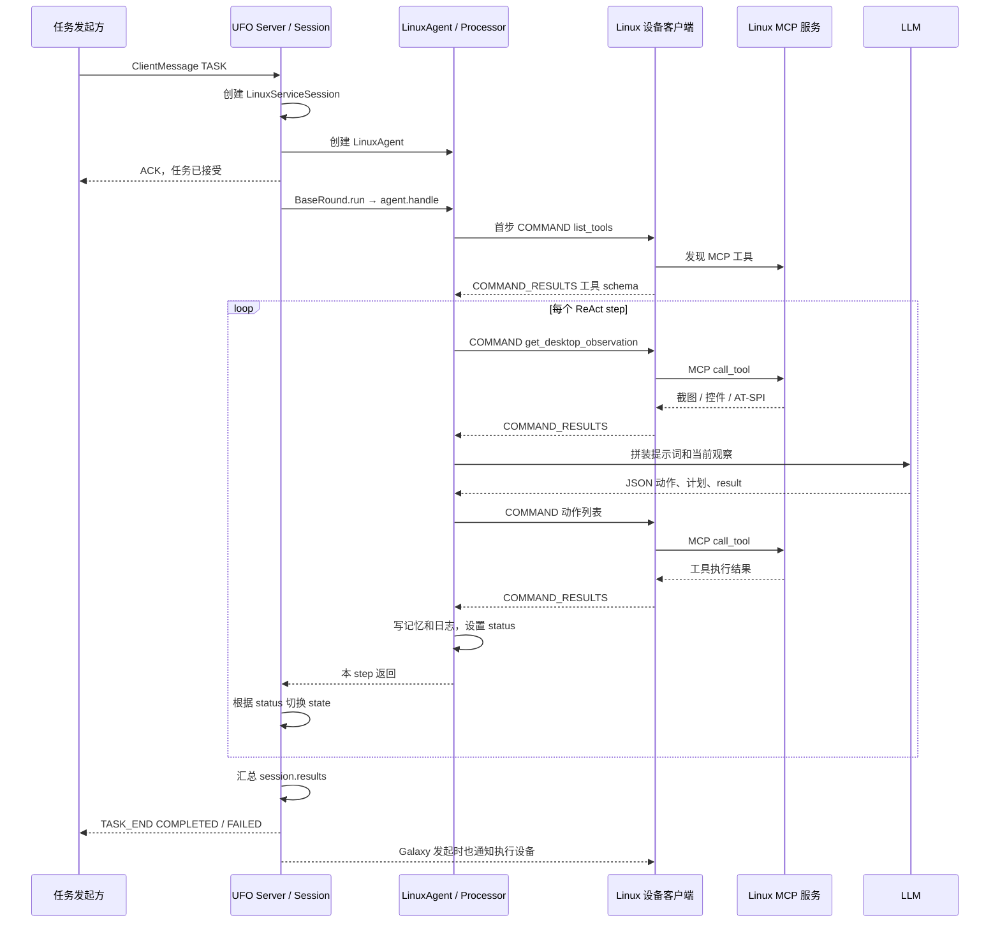

UFO3 LinuxAgent 完整调用链：接收任务、创建与初始化、ReAct、工具执行、结果回传

基于本地仓库 `/home/zhou/GUI-Agent/UFO3`，源码基线 commit `0a1ddc08d5ba72ee2d3ce9ecb1a73e8f9e7e4c8c`。分析日期：2026-11-18。本文是静态源码追踪，没有启动模型调用、桌面操作或远程任务。链接指向本地源码；若后续修改文件，行号可能发生变化。

这里的“命令”需要区分两个入口：用户自然语言任务是 AIP `TASK`；Agent 决策产生的工具调用是 AIP `COMMAND`。前者触发服务端创建 Session/Agent 并启动循环，后者由 Linux 设备客户端执行。LinuxAgent 不是 UFOWebSocketClient，也不是 Linux MCP 服务。

远程模式的职责分布如下。

| 所在位置 | 对象 | 职责 |
|---|---|---|
| 任务发起方 | Galaxy，或设备 CLI，或 HTTP API 调用方 | 提交自然语言任务，接收任务结果 |
| UFO Server 进程 | SessionManager、LinuxServiceSession、LinuxAgent、Processor、状态机 | 管理任务、组织观察、调用模型、选择动作、决定循环结束 |
| Linux 设备客户端进程 | UFOWebSocketClient、UFOClient、CommandRouter、Computer | 接收工具命令，选择 MCP 服务，执行并回传 |
| Linux MCP 服务进程 | LinuxGUI、BashExecutor | 截图、读取 AT-SPI、鼠标键盘操作、执行受限命令 |
| 观察子进程 | observation.py，默认使用 /usr/bin/python3 | 加载系统 pyatspi/GObject，输出桌面观察 JSON |

Linux 是单层 Agent：`LinuxBaseSession._host_agent = None`，直接持有 `_agent: LinuxAgent`。不存在这条主路径上的 HostAgent → AppAgent 任务分发。



1. 启动阶段：先建立服务、连接和注册表。

服务端：[app.py](/home/zhou/GUI-Agent/UFO3/ufo/server/app.py:79)。

```text
加载 ufo.server.app
  → 创建 FastAPI app
  → SessionManager(platform_override=None)
  → ClientConnectionManager()
  → create_api_router(...)
  → UFOWebSocketHandler(...)
  → 注册 /ws 和 /api/* 路由
```

`/ws` 的 `websocket_endpoint()` 先验证连接 token，然后 `await ws_handler.handler(websocket)`。Handler 的 `connect()` 建立当前连接自己的 ConnectionContext，包含注册身份、transport 和 protocol。`handler()` 持续 `receive_text()`，每条消息通过 `asyncio.create_task(handle_message(msg, ctx))` 分发。见 [handler.py](/home/zhou/GUI-Agent/UFO3/ufo/server/ws/handler.py:343)。

设备端：[client.main](/home/zhou/GUI-Agent/UFO3/ufo/client/client.py:81)。

```text
ufo.client.client.main()
  → get_ufo_config()
  → MCPServerManager()
  → ComputerManager(ufo_config.to_dict(), mcp_server_manager)
  → UFOClient(..., client_id, platform)
      → CommandRouter(computer_manager)
      → asyncio.Lock() 作为 task_lock
      → agent/process/root/session 字段初始化为空
  → UFOWebSocketClient(...)
  → create_task(connect_and_listen())
      → websockets.connect(...)
      → WebSocketTransport(ws)
      → RegistrationProtocol / HeartbeatProtocol / TaskExecutionProtocol
      → register_client()
          → asyncio.to_thread(DeviceInfoProvider.collect_system_info, ...)
          → registration_protocol.register_as_device(..., platform)
          → connected_event.set()
      → handle_messages()
          → recv_loop() 与 heartbeat_loop() 两个任务
```

此时创建的只是设备执行框架，尚未创建服务端 LinuxAgent，也尚未通过 `Computer.async_init()` 发现 MCP 工具。Computer 在首条工具命令到来时懒创建。设备注册见 [websocket.py](/home/zhou/GUI-Agent/UFO3/ufo/client/websocket.py:149)。

LinuxAgent 类在模块导入时经过装饰器：

```python
@AgentRegistry.register(
    agent_name="LinuxAgent", third_party=True,
    processor_cls=LinuxAgentProcessor,
)
class LinuxAgent(CustomizedAgent): ...
```

`AgentRegistry.register()` 检查 `enabled_third_party_agents`，启用时绑定 `LinuxAgent._processor_cls = LinuxAgentProcessor`，并保存 `_registry["LinuxAgent"] = LinuxAgent`。这是类注册，实例创建在后面。见 [注册装饰器](/home/zhou/GUI-Agent/UFO3/ufo/agents/agent/basic.py:420) 和 [LinuxAgent 声明](/home/zhou/GUI-Agent/UFO3/ufo/agents/agent/customized_agent.py:43)。

2. 接收自然语言任务：三个远程入口汇合到同一服务端处理函数。

设备 CLI 入口：

```text
client.main() 检测 args.request_text
  → await connected_event.wait()
  → ws_client.start_task(request_text, task_name)
      → 创建 task_loop 后台任务
      → async with ufo_client.task_lock
      → ufo_client.reset()
          → 清空 session/agent/process/root
          → computer_manager.reset()
          → mcp_server_manager.reset()
      → task_protocol.send_task_request(...)
          → ClientMessage(type=TASK, request=..., client_type=DEVICE)
          → AIPProtocol.send_message()
          → WebSocketTransport.send()
          → adapter.send()
```

`start_task()` 内的 `task_loop` 只负责发送请求，不是 ReAct loop；它发送完成就结束，不等待整个任务完成。见 [start_task](/home/zhou/GUI-Agent/UFO3/ufo/client/websocket.py:309) 和 [send_task_request](/home/zhou/GUI-Agent/UFO3/aip/protocol/task_execution.py:44)。

HTTP 分发入口：

```text
POST /api/dispatch
  → dispatch_task_api(data)
  → 检查 request/client_id/task_name，确认设备在线
  → TaskExecutionProtocol.send_task_assignment(...)
  → 向设备发送 ServerMessage(type=TASK, user_request=...)
  → 设备 recv_loop → handle_message
  → start_task(data.user_request, data.task_name)
  → 设备重新向服务端发送 ClientMessage(type=TASK)
```

HTTP 接口返回 `status="dispatched"` 只意味着分发完成。它不是在 HTTP 请求协程里直接执行 LinuxAgent。见 [dispatch_task_api](/home/zhou/GUI-Agent/UFO3/ufo/server/services/api.py:46)。

Galaxy 入口：

```text
DeviceManager.assign_task_to_device(...)
  → 构造 TaskRequest
  → 设备忙则入队、等待 Future；空闲则立即执行
  → _execute_task_on_device()
      → 设置设备 BUSY，发布状态事件
      → WebSocketConnectionManager.send_task_to_device()
          → ClientMessage(
                type=TASK, client_type=CONSTELLATION,
                target_id=device_id,
                session_id=f"{task_name}@{task_id}",
                request=task_request.request)
          → transport.send(...)
          → 等待 _wait_for_task_response(...) 的 Future
```

Galaxy 直接向 UFO Server 发 ClientMessage.TASK，由服务端选择目标设备；不用先让设备执行 `start_task()`。见 [DeviceManager](/home/zhou/GUI-Agent/UFO3/galaxy/client/device_manager.py:551) 和 [send_task_to_device](/home/zhou/GUI-Agent/UFO3/galaxy/client/components/connection_manager.py:275)。

3. 服务端任务入口：分配 Session 和执行设备。

```text
UFOWebSocketHandler.handle_message(msg, ctx)
  → 解析 ClientMessage，并校验/绑定已注册连接身份
  → type == TASK
  → await handle_task_request(data, ctx)
      → CONSTELLATION：查 target_id 对应的设备，取设备 platform
      → DEVICE：只能面向自身，取注册设备 platform
      → 使用 data.session_id，缺失时生成 UUID
      → 清理 task_name，使其可作为日志目录名
      → 定义完成回调 send_result(sid, result_msg)
      → 获取目标设备的 task_protocol
      → await session_manager.execute_task_async(
            session_id, task_name, request,
            task_protocol=目标设备协议,
            platform_override=目标设备平台,
            callback=send_result,
            owner_client_id=请求方,
            executor_client_id=执行设备)
      → 在请求方连接上发送 ACK
```

注意请求方和执行设备可以不同：Galaxy 是 Session owner，Linux 设备是 command result sender。该区分同时影响工具命令发往哪里、工具结果从哪里接受、最终任务结果回给谁。见 [handle_task_request](/home/zhou/GUI-Agent/UFO3/ufo/server/ws/handler.py:668)。

`SessionManager.execute_task_async()` 先同步创建/取得 Session，登记允许回传工具结果的设备，然后才创建后台执行任务：

```text
execute_task_async()
  → get_or_create_session()
      → 查 sessions[session_id]
      → 已有 Session：校验 owner 后复用
      → 新 Session：SessionFactory.create_service_session(..., platform_override)
          → platform == linux
          → LinuxServiceSession(...)
      → 保存 sessions、session_id_dict、owner 映射
  → register_result_sender(session_id, executor_client_id)
  → asyncio.create_task(_run_session_background(session_id, session, callback))
  → _running_tasks[session_id] = task
  → 返回 session_id
```

见 [execute_task_async](/home/zhou/GUI-Agent/UFO3/ufo/server/services/session_manager.py:319)、[get_or_create_session](/home/zhou/GUI-Agent/UFO3/ufo/server/services/session_manager.py:103)、[create_service_session](/home/zhou/GUI-Agent/UFO3/ufo/module/session_pool.py:270)。

4. Session 构造期间创建 LinuxAgent，调用顺序要考虑动态派发。

Session 继承关系：`LinuxServiceSession → LinuxSession → LinuxBaseSession → BaseSession`。

```text
LinuxServiceSession.__init__
  → self.task_protocol = task_protocol
  → LinuxSession.__init__
      → self._mode = "normal"
      → self._init_request = request
      → BaseSession.__init__
          → 保存 task / id / should_evaluate
          → 创建 logs/<safe_task>/
          → self._rounds = {}
          → self._context = Context()
          → self._init_context()                    # 动态调用 LinuxServiceSession 版本
              → LinuxSession._init_context()
                  → BaseSession._init_context()
                      → ID、LOG_PATH
                      → response.log / request.log / evaluation.log 的 FileWriter
                      → SESSION_COST=0、SESSION_STEP=0
                  → MODE="normal"
                  → MCPServerManager()
                  → LocalCommandDispatcher(...)
                  → attach_command_dispatcher(local)
              → WebSocketCommandDispatcher(self, protocol=self.task_protocol)
              → attach_command_dispatcher(websocket) # 替换先前的 local dispatcher
          → self._finish = False
          → self._results = []
          → self._host_agent = None
          → self._init_agents()                     # LinuxBaseSession 实现
              → self._host_agent = None
              → AgentFactory.create_agent("LinuxAgent", "LinuxAgent", prompt, example)
```

先建立 Context/Dispatcher，再创建 Agent。远程构造过程中确实短暂创建过 LocalCommandDispatcher，但最终挂载的是 WebSocketCommandDispatcher，后续工具执行走远程设备。见 [Session 构造](/home/zhou/GUI-Agent/UFO3/ufo/module/basic.py:461)、[LinuxSession](/home/zhou/GUI-Agent/UFO3/ufo/module/sessions/linux_session.py:33)、[LinuxServiceSession](/home/zhou/GUI-Agent/UFO3/ufo/module/sessions/linux_session.py:135)。

`AgentFactory.create_agent()` 的第一个 `"LinuxAgent"` 是类型选择，第二个是实例 name。它从 AgentRegistry 取类并执行构造。见 [AgentFactory](/home/zhou/GUI-Agent/UFO3/ufo/agents/agent/host_agent.py:121)、[LinuxBaseSession._init_agents](/home/zhou/GUI-Agent/UFO3/ufo/module/sessions/platform_session.py:56)。

Agent 继承关系：`LinuxAgent → CustomizedAgent → AppAgent → BasicAgent`，其中 CustomizedAgent 没有自己的初始化实现。

```text
LinuxAgent.__init__(name, main_prompt, example_prompt)
  → AppAgent.__init__(process_name=None, app_root_name=None, is_visual=None, ...)
      → BasicAgent.__init__(name)
          → _step=0、_complete=False、_name=name
          → _status="CONTINUE"
          → _register_self()
          → RetrieverFactory()
          → Memory()
          → _host=None、_processor=None、_state=None
          → PresenterFactory.create_presenter(...)
      → self.get_prompter(...)                      # 动态调用 LinuxAgent 版本
          → LinuxAgentPrompter(main_prompt, example_prompt)
              → AppAgentPrompter → BasicPrompter
              → yaml.safe_load 主模板和示例模板
              → api_prompt_template=None
      → 保存 process/root，初始化各 retriever=None
      → _mode="normal"
      → set_state(self.default_state)              # 已经是 ContinueLinuxAgentState
      → _context_provision_executed=False
      → _processor=None
  → self._blackboard=Blackboard()
  → 再次 set_state(ContinueLinuxAgentState())
  → _context_provision_executed=False
```

模型、MCP 和桌面动作都没有在构造阶段执行。API prompt 此时尚未填充；首次处理任务时才查询工具。`is_visual=None` 用来处理模板路径，不能据此判断这个 LinuxAgent 不接收截图。见 [LinuxAgent.__init__](/home/zhou/GUI-Agent/UFO3/ufo/agents/agent/customized_agent.py:51)、[AppAgent.__init__](/home/zhou/GUI-Agent/UFO3/ufo/agents/agent/app_agent.py:49)、[BasicAgent.__init__](/home/zhou/GUI-Agent/UFO3/ufo/agents/agent/basic.py:39)。

5. Session loop 与真正的 Agent loop。

```text
SessionManager._run_session_background()
  → await session.run()                            # BaseSession.run
      → while not session.is_finished():
          → LinuxSession.create_new_round()
              → next_request()
                  → 第一轮取 _init_request
                  → 空请求时 first_request()；后续轮走交互输入
              → 再检查 session.is_finished()
              → BaseRound(request, self._agent, shared_context, ..., id=total_rounds)
                  → _state=agent.state
                  → _init_context()
                      → ROUND_STEP[id]=0
                      → ROUND_COST[id]=0
                      → ROUND_SUBTASK_AMOUNT[id]=0
                      → REQUEST=request
                      → CURRENT_ROUND_ID=id
              → add_round(round.id, round)
          → round_result = await round.run()
          → results.append({"request": round.request, "result": round_result})
      → capture_last_snapshot()
      → 按配置 evaluation / save_log_to_markdown
      → print_cost()
      → return self.results
```

Session 包含多个 Round；Round 对应一次用户请求；一个 Round 包含多个 ReAct step。当前文件配置 `MAX_ROUND=1`、`MAX_STEP=50`，实际运行仍可能受配置覆盖影响。`MAX_STEP` 比较的是共享的 SESSION_STEP，不是单独某个 Round 的步数。

Agent loop 的实际 while 在 [BaseRound.run](/home/zhou/GUI-Agent/UFO3/ufo/module/basic.py:156)：

```python
while not self.is_finished():
    await self.agent.handle(self.context)
    self.state = self.agent.state.next_state(self.agent)
    self.agent = self.agent.state.next_agent(self.agent)
    self.agent.set_state(self.state)
    if self.state.is_subtask_end():
        time.sleep(ufo_config.system.sleep_time)
        await self.capture_last_snapshot(sub_round_id=self.subtask_amount)
        self.subtask_amount += 1
```

Linux 的 `next_agent()` 返回原 Agent，没有换 Agent。每轮的 step 入口是：

```text
BaseRound.run
  → BasicAgent.handle(context)
  → self.state.handle(self, context)
  → ContinueLinuxAgentState.handle(agent, context)
  → await agent.process(context)
  → AppAgent.process(context)                      # LinuxAgent 继承的方法
```

见 [BasicAgent.handle](/home/zhou/GUI-Agent/UFO3/ufo/agents/agent/basic.py:251)、[ContinueLinuxAgentState.handle](/home/zhou/GUI-Agent/UFO3/ufo/agents/states/linux_agent_state.py:148)、[AppAgent.process](/home/zhou/GUI-Agent/UFO3/ufo/agents/agent/app_agent.py:369)。

6. 首个 step 的一次性初始化：工具发现发生在观察和模型调用之前。

`AppAgent.process()` 的精确顺序：

```text
if not _context_provision_executed:
  → await context_provision(context=context)
  → _context_provision_executed=True
检查 _processor_cls
→ self.processor = self._processor_cls(agent=self, global_context=context)
→ await self.processor.process()
→ self.status = self.processor.processing_context.get_local("status")
```

因此 Agent 和 Memory 跨 step 保留，但 Processor 和它的 local context 每个 step 新建。成功完成的 context provisioning 不会每步重复。

首次 `context_provision()` 继承 AppAgent：按 RAG 配置建立检索器，然后 `_load_mcp_context()`：

```text
AppAgent._load_mcp_context(context)
  → dispatcher.execute_commands([
       Command(tool_name="list_tools",
               parameters={"tool_type":"action"}, tool_type="action")])
  → 从 result[0].result 取工具描述列表
  → [MCPToolInfo(**tool) for tool in tool_list]
  → context.TOOL_INFO[agent.name] = tools_info
  → prompter.create_api_prompt_template(tools_info)
      → BasicPrompter.tools_to_llm_prompt(tools)
```

这条 `list_tools` 同样通过远程命令往返，下面第 10 项详细展开。它最终在设备 `Computer` 内作为 meta tool 执行，返回初始化时收集到的 action 工具 schema。见 [context_provision](/home/zhou/GUI-Agent/UFO3/ufo/agents/agent/app_agent.py:481)、[工具 prompt 生成](/home/zhou/GUI-Agent/UFO3/ufo/prompter/agent_prompter.py:214)。

Linux 当前的 LLM 策略显式传 `dynamic_examples=[]`、`dynamic_knowledge=""`，不调用通用 AppLLM 策略的动态知识检索流程。因此“初始化了 retriever”不等于“这一分支把检索内容送进了模型”。静态 YAML 示例仍会加入 system prompt。

7. 每步创建 Processor：策略装配与 Context 数据流。

继承链为 `LinuxAgentProcessor → CustomizedProcessor → AppAgentProcessor → ProcessorTemplate`。最终运行的流程函数是 [ProcessorTemplate.process](/home/zhou/GUI-Agent/UFO3/ufo/agents/processors/core/processor_framework.py:337)。

```text
ProcessorTemplate.__init__(agent, global_context)
  → 保存 Agent 和共享 Context
  → strategies={}，middleware_chain=[]
  → StrategyDependencyValidator()
  → LinuxAgentProcessor._setup_strategies()
  → LinuxAgentProcessor._setup_middleware()
  → _create_processing_context()
      → get_processor_context_class() = AppAgentProcessorContext
      → _create_local_context(...)
          → _get_common_context_data()
          → AppAgentProcessor._get_processor_specific_context_data()
      → ProcessingContext(global_context, local_context)
  → _validate_strategy_chain()
```

初始 local context 获取 dispatcher、agent_name、session_step、round_step、round_num、request、log_path，以及通用 AppAgent 的 subtask/process/root 字段。Linux 没有 HostAgent 去设置这些 Windows 应用字段，很多值为空。

四个策略及顺序：

| Phase | 实例 | fail_fast |
|---|---|---|
| DATA_COLLECTION | LinuxDesktopCollectionStrategy | False |
| LLM_INTERACTION | LinuxLLMInteractionStrategy | True |
| ACTION_EXECUTION | LinuxActionExecutionStrategy | False |
| MEMORY_UPDATE | AppMemoryUpdateStrategy | False |

Middleware 只有 `LinuxLoggingMiddleware`，继承 AppAgentLoggingMiddleware。枚举还含 SETUP/CLEANUP，但 Linux 没给这两个阶段注册 strategy，不会执行对应阶段。见 [LinuxAgentProcessor](/home/zhou/GUI-Agent/UFO3/ufo/agents/processors/customized/customized_agent_processor.py:97)。

执行模板：

```text
process()
  → 建立并激活 LatencyTracker
  → middleware.before_process()
  → 按 ProcessingPhase 枚举顺序，对已注册的 phase：
      → 校验 depends_on
      → await strategy.execute(agent, processing_context)
      → 记录 execution_time / phase
      → 校验 provides
      → set_phase_result(phase, result)
      → result.success=False：middleware.on_error()，break
      → 成功：update_local(result.data)，让下一阶段读取
  → 记录 phase_results 和 latency
  → _finalize_processing_context()
  → 逆序 middleware.after_process()
  → return combined_result
  → finally 重置 latency tracker
```

`ProcessingContext.get()` 优先 local、再 global；`set_local()` 对已知字段写 dataclass 属性，未知字段放 custom_data。global Context 属于 Session，local context 只属于本步 Processor。见 [ProcessingContext](/home/zhou/GUI-Agent/UFO3/ufo/agents/processors/context/processing_context.py:224)。

8. Observe：每步采集桌面，保存截图与结构化信息。

```text
LinuxDesktopCollectionStrategy.execute()
  → dispatcher.execute_commands([
      Command("get_desktop_observation", {}, tool_type="data_collection")])
  → 检查结果存在且 Result.status == SUCCESS
  → 检查 observation 为 dict 且有 screenshot_url
  → 保存 action_step<N>.png
  → 保存 action_step<N>_annotated.png
  → 保存 action_step<N>_ui.json（过滤截图 data URL 后的 metadata）
  → 返回 ProcessingResult(success=True, data={
        clean_screenshot_path, annotated_screenshot_path,
        clean_screenshot_url, annotated_screenshot_url,
        desktop_observation=metadata})
```

N 是本步开始时的 SESSION_STEP，因此首步编号 0。文件保存在服务端 Session 的 log_path。见 [LinuxDesktopCollectionStrategy](/home/zhou/GUI-Agent/UFO3/ufo/agents/processors/strategies/linux_agent_strategy.py:34)。

采集工具在设备上的落地链：

```text
LinuxGUI MCP get_desktop_observation(api_key, app_name=None)
  → authenticate(api_key)
  → LinuxDesktop.get_desktop_observation(app_name)
      → 清空 self.controls
      → subprocess.run([observation_python, observation.py, ...], timeout=45)
          → capture_observation(app_name)
              → 检查 X11；Wayland 分支报错
              → PIL.ImageGrab.grab(...) 获取桌面截图
              → active_window()
                  → xprop 读取前台窗口 ID、PID、标题
              → pyatspi.Registry.getDesktop(0)
              → 按应用/前台 PID/标题/活动窗口筛选候选窗口
              → visit(...) 遍历 AT-SPI
                  → 收集 node id、parent、name、role、bounds、states
                  → 提取可见可交互控件，生成 control_id
                  → 边界去重和屏幕范围裁剪
                  → 5000 节点 / 深度 40 / 20 秒等截断约束
                  → 大虚拟表格仅遍历选中单元格
              → PIL 画控件框和数字标注
              → png_url() 编码两张截图
              → print(JSON)
      → json.loads(stdout)
      → self.controls={control_id: control}
      → 返回 observation
```

Observation 字段包括 `screenshot_url`、`annotated_screenshot_url`、`ui_tree`、`controls`、`active_window`、`selected_windows`、`screen_size`、`warnings`。见 [MCP 入口](/home/zhou/GUI-Agent/UFO3/ufo/client/mcp/http_servers/linux_gui_mcp_server.py:24)、[LinuxDesktop](/home/zhou/GUI-Agent/UFO3/ufo/automator/linux/desktop.py:14)、[capture_observation](/home/zhou/GUI-Agent/UFO3/ufo/automator/linux/observation.py:43)。

有两个降级层次：AT-SPI 不可用时，观察脚本通常仍返回截图和 warnings；整个观察失败时，LinuxDesktopCollectionStrategy 捕获异常，返回 success=True 但截图为空、controls/ui_tree 为空并携带 warnings。不会复用上一张截图，后续仍可尝试 CLI 工具。

9. Reason：拼装提示词、模型调用、解析动作。

```text
LinuxLLMInteractionStrategy.execute(agent, context)
  → request=context.get("request")
  → _get_prev_plan(agent)
      → 最新 MemoryItem 的 plan，首步为 []
  → agent.blackboard.blackboard_to_prompt()，空 blackboard 则 []
  → _get_last_success_actions(agent)
      → 最新 MemoryItem 的 action_representation
  → agent.message_constructor(..., 当前两张截图, desktop_observation)
```

`LinuxAgent.message_constructor()`：

```text
→ LinuxAgentPrompter.system_prompt_construction(dynamic_examples)
    → api_prompt_helper()：首次发现的工具 schema 文本
    → examples_prompt_helper()：静态 YAML 示例 + 额外示例
    → 主模板 system.format(apis=..., examples=...)
→ LinuxAgentPrompter.user_content_construction(...)
    → Current desktop + 原始截图 image_url
    → Numbered controls + 标注截图 image_url
    → observation metadata JSON 文本
    → user_prompt_construction(...)
        → 用户任务、上一轮动作结果、上一轮计划
        → 用户输入经过 sanitize_user_input()
→ 将 blackboard_prompt 放在 user content 前面
→ BasicPrompter.prompt_construction(system_prompt, user_content)
    → [{role:"system",content:...}, {role:"user",content:[...]}]
```

这条分支每步重新构造消息，不是持续向聊天 messages 数组追加 assistant/tool 消息。跨步信息靠 Memory 和 Blackboard 重新注入。`_get_last_success_actions()` 名称容易误导：实际读取的 action_representation 默认包含失败结果及错误信息，模型能据此纠错。见 [Linux LLM 策略](/home/zhou/GUI-Agent/UFO3/ufo/agents/processors/strategies/linux_agent_strategy.py:99)、[LinuxAgent.message_constructor](/home/zhou/GUI-Agent/UFO3/ufo/agents/agent/customized_agent.py:100)、[Prompter](/home/zhou/GUI-Agent/UFO3/ufo/prompter/customized/linux_agent_prompter.py:33)。

模型调用逐层下钻：

```text
LinuxLLMInteractionStrategy.execute()
  → await AppLLMInteractionStrategy._get_llm_response(agent, prompt_message)
      → for retry_count in range(system.json_parsing_retry)
          → loop.run_in_executor(None, agent.get_response,
                                 prompt_message, AgentType.APP, True)
              → BasicAgent.get_response(...)
              → llm_call.get_completion(...)
                  → get_completions(..., n=1)
                      → get_agent_config(AgentType.APP)
                      → 读取 API_TYPE / API_MODEL
                      → BaseService.get_service(api_type, APP, model)
                          → 动态导入并创建对应服务
                      → service.chat_completion(messages, n)
                      → 返回 response list / cost
                  → 返回 responses[0] / cost
          → agent.response_to_dict(response_text) 先检查 JSON 是否可解析
          → 成功则 return response_text, cost
  → _parse_app_response(agent, response_text)
      → response_to_dict → utils.json_parser
      → processors.schemas.response_schema.AppAgentResponse.model_validate(...)
      → agent.print_response(parsed_response, print_action=False)
  → parsed_response.model_dump()
  → ProcessingResult(data={parsed_response,response_text,llm_cost,prompt_message,...})
```

LinuxAgent 使用的是 `APP` 模型配置，不是一个独立的 `LinuxAgent` 模型配置段。同步 LLM 请求放在线程执行器中，避免阻塞服务端 WebSocket 事件循环。见 [_get_llm_response](/home/zhou/GUI-Agent/UFO3/ufo/agents/processors/strategies/app_agent_processing_strategy.py:1298)、[llm_call](/home/zhou/GUI-Agent/UFO3/ufo/llm/llm_call.py:17)、[服务工厂](/home/zhou/GUI-Agent/UFO3/ufo/llm/base.py:23)。

若配置选择 OpenAIService，继续走 `OpenAIService.chat_completion → BaseOpenAIService._chat_completion`；普通分支调用 `client.chat.completions.create`，`use_responses` 分支调用 `_responses_completion → client.responses.create`。其他 API_TYPE 进入相应 provider。不要将某一个 provider 当成 LinuxAgent 固定调用方式。见 [OpenAIService](/home/zhou/GUI-Agent/UFO3/ufo/llm/openai.py:763)。

存在两层重试/回退：外层 `JSON_PARSING_RETRY` 控制调用和 JSON 可解析检查的总尝试次数；`llm_call.get_completions()` 在 provider 调用失败时，可按配置回退到 BACKUP。完整 Pydantic schema 验证发生在外层重试循环之后，schema 不匹配不等同于 JSON 解析失败重试。当前 system.yaml 的 JSON_PARSING_RETRY=1 代表只尝试一次。

实际被解析的 schema 位于 [processors/schemas/response_schema.py](/home/zhou/GUI-Agent/UFO3/ufo/agents/processors/schemas/response_schema.py:26)：

```json
{
  "observation": "对当前环境的描述",
  "thought": "模型输出的本步决策说明",
  "action": {
    "function": "click_control",
    "arguments": {"control_id": "7"},
    "status": "CONTINUE"
  },
  "plan": ["下一步检查结果"],
  "save_screenshot": {"save": false, "reason": ""},
  "result": null
}
```

`action` 可以是单个 ActionCommandInfo、列表或 None；状态在 `action.status`，不是此 schema 的顶层 status。`thought` 是被读取和记录的文本字段，不是一个独立的执行函数。本文的 ReAct 指观察、模型决策、动作、结果反馈这条执行结构。

10. Act：将模型动作转换为 Command。

```text
LinuxActionExecutionStrategy.execute()
  → parsed_response=context.get_local("parsed_response")
  → command_dispatcher=context.global_context.command_dispatcher
  → _execute_app_action(dispatcher, parsed_response.action)
      → actions 为 None/空列表：直接返回 []
      → 单动作转列表
      → 每个非空 function 调用 _action_to_command()
          → Command(tool_name=action.function,
                    parameters=action.arguments or {}, tool_type="action")
      → await dispatcher.execute_commands(commands)
      → 记录动作执行 latency
      → 返回 List[Result]
  → LinuxActionExecutionStrategy._create_action_info(actions, results)
  → ListActionCommandInfo(actions)
  → color_print() / get_target_info()
  → 计算本步 status
  → 返回 execution_result / action_info / control_log / status
```

这一调用没有 `eval` 模型输出，也不是 LLM 直接调用 Python 函数；模型给出名字和参数，CommandRouter 再查已注册工具。见 [LinuxActionExecutionStrategy](/home/zhou/GUI-Agent/UFO3/ufo/agents/processors/strategies/linux_agent_strategy.py:178)、[_execute_app_action](/home/zhou/GUI-Agent/UFO3/ufo/agents/processors/strategies/app_agent_processing_strategy.py:1559)。

远程 Dispatcher 的完整等待链：

```text
WebSocketCommandDispatcher.execute_commands(commands, timeout=6000)
  → make_server_response(commands)
      → 为每条 Command 生成 call_id
      → agent_name=session.current_agent_class="LinuxAgent"
      → process_name/root_name 从全局 Context 取值，Linux 通常为空
      → 为整批生成 response_id
      → ServerMessage(type=COMMAND, status=CONTINUE,
                       actions=commands, session_id, task_name, ...)
  → 创建 Future
  → pending[response_id]=Future
  → await protocol.send_command(server_message)
      → AIPProtocol.send_message
          → outgoing middleware
          → model_dump_json().encode("utf-8")
          → transport.send
          → WebSocket adapter.send
  → await asyncio.wait_for(Future, timeout)
  → finally 删除 pending[response_id]
```

`6000` 的单位是秒，不是毫秒。发送失败或超时会转换成每条 Command 对应的 `Result(FAILURE, call_id, error, result=error_msg)`。见 [WebSocketCommandDispatcher](/home/zhou/GUI-Agent/UFO3/ufo/module/dispatcher.py:174)、[AIP 发送](/home/zhou/GUI-Agent/UFO3/aip/protocol/base.py:52)、[WebSocket transport](/home/zhou/GUI-Agent/UFO3/aip/transport/websocket.py:177)。

设备接收命令：

```text
UFOWebSocketClient.recv_loop()
  → msg=await ws.recv()
  → handle_message(msg)
      → ServerMessage.model_validate_json(msg)
      → type==COMMAND
      → handle_commands(server_response)
          → 保存 response_id、task_status、self.session_id
          → await ufo_client.execute_step(server_response)
              → 设置 agent_name/process_name/root_name
              → execute_actions(response.actions)
                  → commands 非空时 CommandRouter.execute(...)
```

见 [handle_commands](/home/zhou/GUI-Agent/UFO3/ufo/client/websocket.py:362)、[UFOClient.execute_step](/home/zhou/GUI-Agent/UFO3/ufo/client/ufo_client.py:53)。

首次命令所触发的 Computer 初始化：

```text
CommandRouter.execute()
  → ComputerManager.get_or_create(agent_name, process_name, root_name)
      → key=f"{agent_name}::{process_name}::{root_name or 'default'}"
      → 缓存不存在：
          → 读取 MCP_SERVERS[agent_name][root/default]
          → 取 data_collection 和 action 配置列表
          → Computer(...)
              → _tools_registry={}
              → 线程池 max_workers=10
              → _tool_timeout=6000
              → 注册 list_tools 等 meta tools
          → await computer.async_init()
              → _init_data_collection_servers()
              → _init_action_servers()
                  → MCPServerManager.create_or_get_server(namespace)
                  → 首次 create_mcp_server → HTTPMCPServer.start()
                  → 生成 MCP URL/transport，缓存服务包装对象
              → asyncio.gather(注册 collection 服务, 注册 action 服务)
                  → register_mcp_servers()
                  → register_one_mcp_server()
                      → async with fastmcp.Client(server)
                      → client.list_tools()
                      → _register_tool(...)
                          → key="<tool_type>::<tool_name>"
                          → 保存 MCPToolCall、namespace、schema、server
                      → 注册 meta tools
          → computers[key]=computer
      → 返回缓存 Computer
```

当前配置 [mcp.yaml](/home/zhou/GUI-Agent/UFO3/config/ufo/mcp.yaml:139)：collection 使用 `LinuxGUI localhost:8011/mcp`；action 使用 LinuxGUI 和 `BashExecutor localhost:8010/mcp`。同一 GUI 服务因此能被两种 tool_type 发现。HTTPMCPServer.start() 只建立 URL/transport，不会启动 GUI/Bash 的服务进程，这两个服务要已启动。见 [ComputerManager](/home/zhou/GUI-Agent/UFO3/ufo/client/computer.py:653)、[Computer 初始化](/home/zhou/GUI-Agent/UFO3/ufo/client/computer.py:80)、[HTTPMCPServer.start](/home/zhou/GUI-Agent/UFO3/ufo/client/mcp/mcp_server_manager.py:86)。

发现工具时，如果配置 api_key_env，会从给模型看的 input_schema 删除 api_key 参数。实际执行时再由设备进程读取本地环境变量注入，模型不负责提供认证值。

逐条调用链：

```text
CommandRouter.execute(): for command in commands
  → 无 tool_name：产生 SUCCESS / No action taken
  → 之前有 MCP 调用失败且 early_exit=True：产生 SKIPPED
  → computer.command2tool(command)
      → 确定 tool_type，查 _tools_registry[tool_type::tool_name]
      → deepcopy(command.parameters) 写入 tool call
  → computer.run_actions([tool_call])
      → computer._run_action(tool_call)
          → meta tool：直接调用本地 Computer 方法，必要时 await
          → 普通工具：
              → 深拷贝参数，从 api_key_env 注入 api_key
              → loop.run_in_executor(self._executor, _call_tool_in_thread)
                  → 在线程中新建 asyncio event loop
                  → async with fastmcp.Client(server)
                  → await client.call_tool(name, arguments, raise_on_error=False)
                  → 关闭线程 event loop
              → 外层 asyncio.wait_for(..., 6000)
              → 返回 CallToolResult
  → 根据 call_tool_result.is_error 生成 AIP Result
      → result=call_tool_result.data（为空值时当前代码转 None）
      → status=SUCCESS / FAILURE
      → call_id 保持对应，记录 namespace
  → await asyncio.sleep(0.1)
```

CommandRouter 的同批命令是顺序执行，不是并行。线程池的作用是隔离阻塞调用。见 [CommandRouter.execute](/home/zhou/GUI-Agent/UFO3/ufo/client/computer.py:734)、[command2tool](/home/zhou/GUI-Agent/UFO3/ufo/client/computer.py:553)、[_run_action](/home/zhou/GUI-Agent/UFO3/ufo/client/computer.py:157)。

11. 真正的系统操作：GUI 分支与 CLI 分支。

GUI 工具统一先认证，然后调用 LinuxDesktop。见 [GUI MCP](/home/zhou/GUI-Agent/UFO3/ufo/client/mcp/http_servers/linux_gui_mcp_server.py:35)、[LinuxDesktop 动作](/home/zhou/GUI-Agent/UFO3/ufo/automator/linux/desktop.py:26)。

| 工具 | 最终实现 |
|---|---|
| list_windows | wmctrl -lpG，解析窗口 ID、PID、标题和 bounds |
| activate_window | wmctrl -ia，随后清空 controls 缓存 |
| click | pyautogui.click |
| click_control | 从最新 self.controls 查 bounds，算中心点，转 click |
| scroll | pyautogui.moveTo → scroll |
| type_text | pyperclip.copy → pyautogui.hotkey("ctrl", "v") |
| press_keys | 验证 PyAutoGUI 键名 → pyautogui.hotkey(*keys) |
| drag | pyautogui.moveTo → dragTo |

control_id 只对应最近一次观察的缓存，激活另一窗口会失效。下一步观察更新缓存后不能继续把旧编号解释为旧控件。

CLI 分支：

```text
BashExecutor MCP execute_command(command, api_key, timeout=30, cwd=None)
  → _validate_api_key()
  → _is_command_allowed(command)
      → 命令分词、白名单、参数策略等检查
  → timeout 限制到 1..120 秒
  → _validate_cwd()
  → _execute_allowed_command(..., executable_paths)
      → _tokenize(command)
      → 取预先解析的可信可执行文件路径
      → asyncio.create_subprocess_exec(executable, *args,
            stdout=PIPE, stderr=PIPE, cwd=..., start_new_session=...)
      → 两个 _read_stream_limited 任务 + proc.wait 任务
      → wait_for(gather(...), timeout)
      → 超时/输出超限/取消：清理执行进程与读取任务
      → 返回 {success, exit_code, stdout, stderr} 或 {success:false,error}
```

它不启动 shell，不支持把管道、重定向、命令链当 shell 程序执行。Prompt 中较泛化的“bash”描述不能替代实际调用语义。见 [execute_command](/home/zhou/GUI-Agent/UFO3/ufo/client/mcp/http_servers/linux_mcp_server.py:800)、[_execute_allowed_command](/home/zhou/GUI-Agent/UFO3/ufo/client/mcp/http_servers/linux_mcp_server.py:653)。

12. 工具结果返回：恢复服务端暂停的当前 step。

```text
设备 CommandRouter.execute() 返回 List[Result]
  → UFOClient.execute_actions 返回
  → UFOClient.execute_step 返回
  → UFOWebSocketClient.handle_commands()
      → task_protocol.send_task_result(
            session_id,
            prev_response_id=原 COMMAND.response_id,
            action_results,
            status=原 COMMAND.status,
            client_id)
          → send_command_results()
          → ClientMessage(type=COMMAND_RESULTS, action_results, ...)
          → AIPProtocol.send_message → transport → WebSocket

服务端 handler.receive_text()
  → handle_message(type=COMMAND_RESULTS)
  → handle_command_result(data, ctx)
      → response_id=data.prev_response_id
      → get_session(data.session_id)，只查已有 Session
      → 校验发送者是该 Session 的执行设备
      → session.context.command_dispatcher.set_result(response_id, data)
          → fut=pending.get(response_id)
          → fut.set_result(data.action_results)

服务端当前 step 的 execute_commands() 被唤醒
  → 返回 List[Result]
  → _execute_app_action 返回
  → LinuxActionExecutionStrategy 继续处理结果
```

这里 `send_task_result()` 是 `send_command_results()` 的封装，不是任务完成上报。主任务是否完成由服务端后续状态机决定。工具结果里的 `status` 参数继承 COMMAND 消息的 TaskStatus.CONTINUE，具体某条工具成功与否看 action_results 中各 Result.status。见 [AIP send_task_result](/home/zhou/GUI-Agent/UFO3/aip/protocol/task_execution.py:198)、[服务端接收](/home/zhou/GUI-Agent/UFO3/ufo/server/ws/handler.py:947)、[set_result](/home/zhou/GUI-Agent/UFO3/ufo/module/dispatcher.py:244)。

三个 ID 的关联意义：session_id 定位任务 Session；response_id/prev_response_id 对应一批 Command 的 Future；call_id 对应批内单个工具调用及其 Result。LinuxActionExecutionStrategy 给 action 绑定 Result 时按顺序迭代，并不是按 call_id 建映射。

13. 本步动作结果如何影响下一步。

`_create_action_info()` 逐动作处理：

- function 为空：本地补 SUCCESS / No action taken，不消费工具结果。
- 缺少对应返回值：补 FAILURE / Missing execution result。
- 工具 payload 是 dict，且 success=False 或 exit_code 非 0：即使 AIP Result 原本为 SUCCESS，也改为 FAILURE，并从 error/stderr/exit_code 生成错误信息。
- 将 Result 挂到 ActionCommandInfo.result。

计算 status：单个动作取它的 action.status；列表走 ListActionCommandInfo.status，按成功动作更新为最后一个成功动作的 status；无动作列表默认 FINISH。如果 status 不是 FAIL，但任一动作结果不为 SUCCESS，强制改成 CONTINUE。

因此模型输出 FINISH，但点击/命令实际失败时，会再进入下一 step。若模型明确给 FAIL，则保持 FAIL。见 [Linux 动作归一化](/home/zhou/GUI-Agent/UFO3/ufo/agents/processors/strategies/linux_agent_strategy.py:217)、[列表状态计算](/home/zhou/GUI-Agent/UFO3/ufo/agents/processors/schemas/actions.py:128)。

这里有一项批处理细节：CommandRouter 的 early_exit 根据 MCP 的 is_error 判断；LinuxActionExecutionStrategy 对 payload.success/exit_code 的判断发生在整个 batch 返回之后。因此前一个 CLI 工具返回 `{success:false}` 但 MCP is_error=False 时，不能保证后续批内动作已经被跳过。

14. Memory、Blackboard、日志和步数回写。

```text
AppMemoryUpdateStrategy.execute()
  → _create_additional_memory_data(agent, context)
      → 收集之前的 action_success
      → action_info.get_function_calls()
      → action_info.to_list_of_dicts()：含执行结果的动作
      → success_only=True：单独提取成功动作
      → action_type：工具 namespace
      → action_representation：动作、状态、错误、结果文本
      → 写 session_step / round_step / round_num / agent_step
      → 写 request、cost、results 等字段
  → _create_and_populate_memory_item(parsed_response, additional_memory)
      → 新建 MemoryItem()
      → 写 parsed_response.model_dump()
      → 写 additional_memory.to_dict(selective=True)
  → agent.add_memory(memory_item)
  → _update_blackboard(...)
      → 按 HISTORY_KEYS 从 memory_item 选字段
      → blackboard.add_trajectories(...)
      → 若 save_screenshot.save=True，blackboard.add_image(...)
  → _update_structural_logs()
      → global_context.add_to_structural_logs(memory_item.to_dict())
```

HISTORY_KEYS 当前含 action_representation，因此下一步 Blackboard 可以拿到之前动作的结果；最新 MemoryItem 另行提供上一步 plan 和 action_representation。完整 Memory 不会被不加筛选地拼进下一次模型 messages。见 [Memory 更新策略](/home/zhou/GUI-Agent/UFO3/ufo/agents/processors/strategies/app_agent_processing_strategy.py:1732)、[Blackboard 转 prompt](/home/zhou/GUI-Agent/UFO3/ufo/agents/memory/blackboard.py:274)。

正常 pipeline 收尾：

```text
LinuxAgentProcessor._finalize_processing_context(context)
  → ProcessorTemplate._finalize_processing_context()
      → CURRENT_ROUND_COST += llm_cost
      → SESSION_COST += llm_cost
      → CURRENT_ROUND_STEP += 1
      → SESSION_STEP += 1
  → 若 local result 为真值：global ROUND_RESULT = result
→ LinuxLoggingMiddleware.after_process()，继承父类
  → 记录耗时和 phase execution_times
  → 持久化 latency.steps.jsonl / latency.json / latency.md
  → local_context.to_dict(selective=True)
  → FileWriter.write(JSON) 写 response.log
→ Processor 返回
→ AppAgent.process 设置 self.status = local status
```

注意上述计数递增是正常收尾路径；如果异常被 process() 外层 except 捕获，会进入错误 middleware 后返回，跳过正常 finalize/after_process。见 [finalize](/home/zhou/GUI-Agent/UFO3/ufo/agents/processors/core/processor_framework.py:193)、[Linux finalize](/home/zhou/GUI-Agent/UFO3/ufo/agents/processors/customized/customized_agent_processor.py:124)、[日志 middleware](/home/zhou/GUI-Agent/UFO3/ufo/agents/processors/core/processing_middleware.py:92)。

15. 状态机决定继续还是结束。

Agent.status 是字符串；Agent.state 是状态对象。Processor 先产生字符串，BaseRound 再转换对象：

```text
AppAgent.process 返回
  → BaseRound.run
      → self.agent.state.next_state(self.agent)
          → LinuxAgentState.next_state()
          → LinuxAgentStateManager().get_state(agent.status)
      → next_agent() 返回原 LinuxAgent
      → agent.set_state(new_state)
      → 下次 while 检查 is_finished()
```

| status | state | is_round_end | 后续 |
|---|---|---|---|
| CONTINUE | ContinueLinuxAgentState | False | 再创建 Processor，重新观察和决策 |
| FINISH | FinishLinuxAgentState | True | Round 结束 |
| FAIL | FailLinuxAgentState | True | Round 结束，Session 错误判定为失败 |
| 未注册状态 | NoneLinuxAgentState | True | 终止 Round；这是异常兜底，不是成功证明 |

`FailLinuxAgentState.next_state()` 虽然写着返回 Finish，但正常流程切到 Fail 后下次 while 直接退出，不会再调用 Fail.handle/next_state 去变成 Finish。见 [Linux 状态实现](/home/zhou/GUI-Agent/UFO3/ufo/agents/states/linux_agent_state.py:78)。

Round 的结束条件是 `state.is_round_end() OR SESSION_STEP >= MAX_STEP`。Session 的结束条件是 `_finish OR step>=MAX_STEP OR total_rounds>=MAX_ROUND OR is_error()`。两层结束条件不同；Round 结束不等于 Session 一定结束。当前 MAX_ROUND=1 使一轮结束后 Session 结束。

16. Round 和 Session 返回结果。

```text
BaseRound.run 退出 while
  → agent.blackboard.add_requests({"request_<id>": request})
  → capture_last_snapshot()
  → 按 should_evaluate 调 evaluation()
  → return context.ROUND_RESULT

BaseSession.run
  → results.append({"request": round.request, "result": round_result})
  → 检查 Session 结束条件
  → 尾部截图/评估/日志/成本
  → return session.results
```

结果字段的数据链：

```text
模型 JSON.result
  → parsed_response.result
  → ProcessingContext.local.result
  → LinuxAgentProcessor.finalize：Context.ROUND_RESULT
  → BaseRound.run 返回 round_result
  → session.results = [{request, result}, ...]
  → ServerMessage(TASK_END).result
  → Galaxy ExecutionResult.result / 设备客户端日志
```

最终 result 不会自动设为最后一条工具 stdout；正常路径主要由模型生成的 result 填充，错误 middleware 也可以直接写 ROUND_RESULT。Prompt 要求 FINISH/FAIL 提供 result，但 Pydantic schema 仍将 result 定义为可选，且 Linux finalize 只在值为真时更新，所以“模型省略/给空结果”没有严格的最终结果完整性校验。

17. 任务完成上报、缓存和清理。

```text
SessionManager._run_session_background()
  → await session.run() 返回
  → if session.is_error(): status=TaskStatus.FAILED
  → elif session.is_finished(): status=TaskStatus.COMPLETED
  → else: FAILED，error="Session ended in unknown state"
  → session.reset()
      → LinuxBaseSession.reset()
      → agent.set_state(agent.default_state)
  → finally:
      → ServerMessage(type=TASK_END,
                      status, session_id,
                      result=session.results,
                      error, timestamp, response_id)
      → set_results(session_id)：存入 SessionManager.results
      → await callback(session_id, result_message)
          → handle_task_request 内定义的 send_result
          → 找请求方 task_protocol
          → send_task_end(...)
          → Galaxy 发起时，也对目标设备 send_task_end(...)
      → _running_tasks.pop(session_id)
      → remove_session(session_id)
          → 删除 Session、owner 和授权结果发送者绑定
```

见 [后台任务收尾](/home/zhou/GUI-Agent/UFO3/ufo/server/services/session_manager.py:428)、[send_result 回调](/home/zhou/GUI-Agent/UFO3/ufo/server/ws/handler.py:794)、[AIP TASK_END](/home/zhou/GUI-Agent/UFO3/aip/protocol/task_execution.py:228)。

设备端 `handle_message(TASK_END) → handle_task_end()` 目前只打印成功结果或失败 error，没有在此处自动 reset，也没有调用已有的 send_task_end_ack 方法。下一次设备自己走 start_task() 时才 reset 执行上下文。见 [handle_task_end](/home/zhou/GUI-Agent/UFO3/ufo/client/websocket.py:390)。

Galaxy 收到最终结果：

```text
MessageProcessor._process_server_message(type=TASK_END)
  → _handle_task_completion(device_id, server_msg)
  → connection_manager.complete_task_response(
        server_msg.session_id, server_msg, sender_device_id=device_id)
      → 查 _pending_tasks[session_id]
      → 验证结果来自原分配设备对应的连接
      → task_future.set_result(server_msg)
  → _wait_for_task_response() 返回
  → send_task_to_device() 构造 ExecutionResult(
        task_id,status,error,result,metadata={device_id})
  → DeviceManager._execute_task_on_device() 返回给调用方
```

这个 Future 等待的是整项任务的 TASK_END，与服务端 Dispatcher 等工具命令结果的 Future 不同。见 [Galaxy 完成处理](/home/zhou/GUI-Agent/UFO3/galaxy/client/components/message_processor.py:287)、[完成任务 Future](/home/zhou/GUI-Agent/UFO3/galaxy/client/components/connection_manager.py:451)。

18. 异常路径必须与正常的动作失败分开理解。

| 失败位置 | 当前实现的传播方式 | 是否继续下一 step |
|---|---|---|
| AT-SPI 获取失败但截图成功 | 返回截图和 warnings | 继续 |
| 整个桌面采集失败 | collection 返回 success=True，观察为空并携带 warnings | 继续 |
| MCP 正常返回业务失败，如 success=False | Linux 动作策略将 Result 标为 FAILURE，通常把 status 改 CONTINUE | 通常继续，除非模型已给 FAIL |
| Dispatcher 发送失败或等待超时 | 转换为 Result.FAILURE | 动作路径通常继续；首步工具发现则可能无法完成初始化 |
| 模型调用或 schema 解析异常 | LLM fail_fast=True → ProcessingException → process except → LinuxLoggingMiddleware.on_error | FAIL，结束 |
| action strategy 自身抛异常 | fail_fast=False → ProcessingResult.success=False → process 主循环 on_error + break | FAIL，结束 |
| memory strategy 自身抛异常 | 同上 | FAIL，结束，并非注释暗示的始终忽略 |
| 首步 context_provision 异常 | 发生在 Processor 创建之前，可直接向外传播到 SessionManager | FAILED |
| 超过 MAX_STEP 且没有 FINISH | Round 截止，LinuxSession.is_error=True | FAILED |
| Session 未捕获异常 | SessionManager except 设置 FAILED 和 error | TASK_END 失败 |
| 执行设备断开导致取消 | 设置 device_disconnected 失败原因 | 尝试通知仍连接的请求方 |
| 发起方断开导致取消 | was_cancelled=True | 跳过完成回调 |

`LinuxLoggingMiddleware.on_error()` 明确设置 local status=FAIL、local result=错误字符串、global ROUND_RESULT=错误字符串。见 [Linux 错误 middleware](/home/zhou/GUI-Agent/UFO3/ufo/agents/processors/strategies/linux_agent_strategy.py:276)、[BaseProcessingStrategy.handle_error](/home/zhou/GUI-Agent/UFO3/ufo/agents/processors/strategies/processing_strategy.py:108)、[LinuxSession.is_error](/home/zhou/GUI-Agent/UFO3/ufo/module/sessions/linux_session.py:104)。

19. 本地模式：共用 Agent loop，替换工具分发。

预期入口链是 `ufo.ufo.main → SessionFactory.create_session → _create_linux_session → LinuxSession → SessionPool.run_all → BaseSession.run`。本地 Session 只挂 LocalCommandDispatcher，工具调用变为：

```text
Strategy
  → LocalCommandDispatcher.execute_commands()
      → 分配 call_id
      → asyncio.wait_for(command_router.execute(...), timeout)
      → ComputerManager / Computer / MCP
      → 直接返回 List[Result]
```

没有 COMMAND/COMMAND_RESULTS 网络往返，也没有 SessionManager 的 TASK_END 回调。模型和 Memory/状态机流程与远程路径一致。见 [本地入口](/home/zhou/GUI-Agent/UFO3/ufo/ufo.py:51)、[LocalCommandDispatcher](/home/zhou/GUI-Agent/UFO3/ufo/module/dispatcher.py:93)。

当前源码的 `_create_linux_session()` normal 分支向 LinuxSession 传了 `application_name`，但 LinuxSession.__init__ 不接受这个参数。按这条原始工厂路径会在构造时触发 TypeError。这是静态签名检查发现的现状；不能把它画成已经验证可运行的完整本地路径。服务端使用独立的 create_service_session()，没有传这个多余参数。见 [工厂调用](/home/zhou/GUI-Agent/UFO3/ufo/module/session_pool.py:194)、[实际构造签名](/home/zhou/GUI-Agent/UFO3/ufo/module/sessions/linux_session.py:33)。

20. 阅读当前代码时还要注意的实现差异。

- 有两套同名 AppAgentResponse。实际 `_parse_app_response()` 的全局符号来自 processors/schemas/response_schema.py，为小写字段和 action；linux_agent_strategy.py 导入的 ufo.llm.response_schema.AppAgentResponse 是另一套旧式大写字段，主要形成误导性的类型标注。provider 的 JSON_SCHEMA 分支也引用旧式 schema，启用时存在与 Linux prompt/解析器不一致的风险，需要按配置验证。
- HTTP dispatch 发出一个 session_id，但设备 handle_message(TASK) 只传 user_request/task_name 给 start_task；后者 reset 后用空 session_id 重新请求，所以服务端可能生成新的 session_id。不能无条件认为 HTTP 响应的 ID 就是实际执行 Session ID。
- 当前 HTTP `/api/task_result/{task_name}` 调用的 get_result_by_task() 查询活动 sessions，而完成清理会 remove_session；虽然结果另存到了 SessionManager.results，getter 没有读这个缓存。因此任务完成并清理后，HTTP 轮询可能一直返回 pending。WebSocket TASK_END 推送不依赖该 getter。见 [getter](/home/zhou/GUI-Agent/UFO3/ufo/server/services/session_manager.py:281)。
- 正常 Linux 观察结果没有写入 APPLICATION_WINDOW/APPLICATION_WINDOW_INFO；继承的 Round/Session final snapshot 仅在这些字段非空时执行，且使用 Windows 式 capture_window_screenshot 等工具。不能承诺每个任务都会生成 final.png；稳定的 Linux 观察记录在 action_step<N>.*，是每次决策前的状态。
- LinuxBaseSession.evaluation() 和 save_log_to_markdown() 是 warning + pass，BaseRound.evaluation() 也是空实现。开启配置不代表 Linux 已完成评估和 Markdown 轨迹输出。见 [LinuxBaseSession](/home/zhou/GUI-Agent/UFO3/ufo/module/sessions/platform_session.py:74)。
- request.log 虽在 Session 初始化创建，但 LinuxLLMInteractionStrategy.execute() 不调用通用策略的 _log_request_data()；不能仅凭文件存在认定完整模型请求已逐步写入。
- LinuxActionExecutionStrategy 重写 execute()，没有走 AppActionExecutionStrategy.execute() 的 pending confirmation 分支；Linux 状态管理器也没有 CONFIRM/SCREENSHOT 等 Windows 状态。应沿 Linux override 读实际路径。
- Session.reset() 在 Linux 仅重置 agent.state，未清空 Memory、Blackboard、step 和 context provisioning 标记；服务端随后通常删除 Session。不要将其当成完整的可复用对象重置。
- `FailLinuxAgentState` 会导致明确失败，但未知字符串会映射到终止的 NoneLinuxAgentState。当前 LinuxSession.is_error() 没有覆盖所有“未知状态且 MAX_ROUND 达限”的情形，因此注释中“只有实际 FINISH 才成功”不能当成已被完全保证的不变量。
- Processor 主循环遇到 success=False 时会调用 on_error 并 break，但 combined_result.success 仍初始为 True。业务终止判断看 local status/agent.state/session.is_error，不能只看日志里的 processing completed successfully。

21. 调试时的建议断点顺序。

| 顺序 | 断点 | 重点观察 |
|---|---|---|
| 1 | handler.py:handle_task_request | request、platform、owner、executor、session_id |
| 2 | session_manager.py:execute_task_async | 是新建还是复用、传入的 task_protocol |
| 3 | platform_session.py:LinuxBaseSession._init_agents | prompt 路径、AgentFactory 参数 |
| 4 | customized_agent.py:LinuxAgent.__init__ | _processor_cls、state、prompter、blackboard |
| 5 | basic.py:BaseRound.run | while 边界、SESSION_STEP、state |
| 6 | app_agent.py:AppAgent.process | provisioning 标记、本步 processor 是否新建 |
| 7 | app_agent.py:_load_mcp_context | list_tools 返回值、API prompt |
| 8 | processor_framework.py:process | 当前 phase、local context、phase result |
| 9 | linux_agent_strategy.py:LinuxDesktopCollectionStrategy.execute | 截图、warnings、controls |
| 10 | linux_agent_strategy.py:LinuxLLMInteractionStrategy.execute | prompt_message、parsed_response |
| 11 | linux_agent_strategy.py:LinuxActionExecutionStrategy.execute | action、execution_results、最终 status |
| 12 | dispatcher.py:execute_commands | response_id、pending Future、call_id |
| 13 | 设备 websocket.py:handle_commands | 收到的 actions 和执行 Session |
| 14 | computer.py:CommandRouter.execute / Computer._run_action | registry 命中、namespace、MCP is_error |
| 15 | handler.py:handle_command_result / dispatcher.py:set_result | prev_response_id 是否匹配 pending |
| 16 | app_agent_processing_strategy.py:AppMemoryUpdateStrategy.execute | 记忆中的动作结果和 plan |
| 17 | customized_agent_processor.py:_finalize_processing_context | ROUND_RESULT、SESSION_STEP |
| 18 | linux_agent_state.py:next_state | agent.status → state 的映射 |
| 19 | session_manager.py:_run_session_background | is_error、TaskStatus、session.results |
| 20 | handler.py:send_result | TASK_END 接收方和 payload |

跨进程调试至少要分别附加服务端和设备端；要继续查看 PyAutoGUI、AT-SPI 或 subprocess，则附加相应 MCP 服务/观察子进程。仅在 LinuxAgent 类文件里下断点，会漏掉绝大多数关键逻辑。
